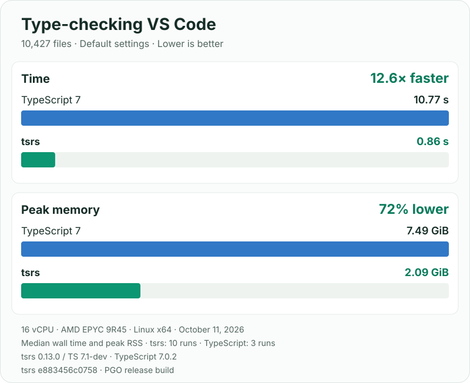

# tsrs

[](https://www.npmjs.com/package/tsrs)
[](LICENSE)

tsrs is a **drop-in replacement for the TypeScript 7 compiler and language server**, written in Rust.
Our goal is **100% conformance**, with much lower memory use and faster type checking.

## Get started

Install tsrs and use it in place of `tsc`, with your existing `tsconfig.json`:

```sh
pnpm add -D tsrs
pnpm exec tsrs -p .             # compile your project
pnpm exec tsrs -p . --noEmit    # type-check only
```

Like `tsc`, tsrs emits JavaScript by default. To try it without installing, run `pnpm dlx tsrs -p . --noEmit`.

Prebuilt binaries are available for macOS arm64 and Linux x64/arm64 (glibc). See
[platform support](docs/COMPATIBILITY.md) for the full list, including upcoming musl builds.

## Less waiting. Less memory.

Type-checking the VS Code repository, with each compiler's default settings:

[](bench/RESULTS.md#vs-code-chart-snapshot)

Snapshot from October 11, 2026, on 16 vCPUs. [Measurement details](bench/RESULTS.md#vs-code-chart-snapshot)
and [latest results across 17 projects](bench/RESULTS.md).

## Compatibility

tsrs follows TypeScript's Go implementation, currently pinned to TypeScript 7.1-dev. Any difference from that
reference is a bug. On the upstream conformance suite, it matches **13,458 of 13,462 error baselines** and all
**12,779 type and symbol baselines**; the four remaining error-baseline differences are test-harness artifacts.

Type checking, JavaScript and declaration emit, source maps, incremental builds, project references and the
language server are supported. Some features still have gaps: `--watch`, `--init` and `--showConfig` are not
supported, and the language server and Node API are still working toward full conformance.
See [compatibility and evidence](docs/COMPATIBILITY.md) for the complete picture.

## Learn more

- [CLI usage and memory tuning](docs/USAGE.md)
- [Editor setup](docs/LSP.md#editor-setup)
- [Node API (unstable)](docs/NODE_API.md)
- [WebAssembly for Node and browsers](npm/tsrs-wasm/README.md)
- [Benchmarks and methodology](bench/README.md)
- [Release notes](docs/STATUS.md)

## Contributing

Bug reports with a small reproduction and fixes are welcome. See the [contributing guide](CONTRIBUTING.md)
for building from source and running the suites, the [Code of Conduct](CODE_OF_CONDUCT.md), and
[security policy](SECURITY.md) for reporting vulnerabilities.

## Acknowledgments and license

Thanks to [@JiangWeixian](https://github.com/JiangWeixian) for transferring the `tsrs` npm package name.

tsrs is a derivative of TypeScript (Copyright Microsoft Corporation), licensed under [Apache-2.0](LICENSE).
The bundled `lib.*.d.ts` files are TypeScript's. See [NOTICE](NOTICE) for attribution.
Not affiliated with or endorsed by Microsoft.
