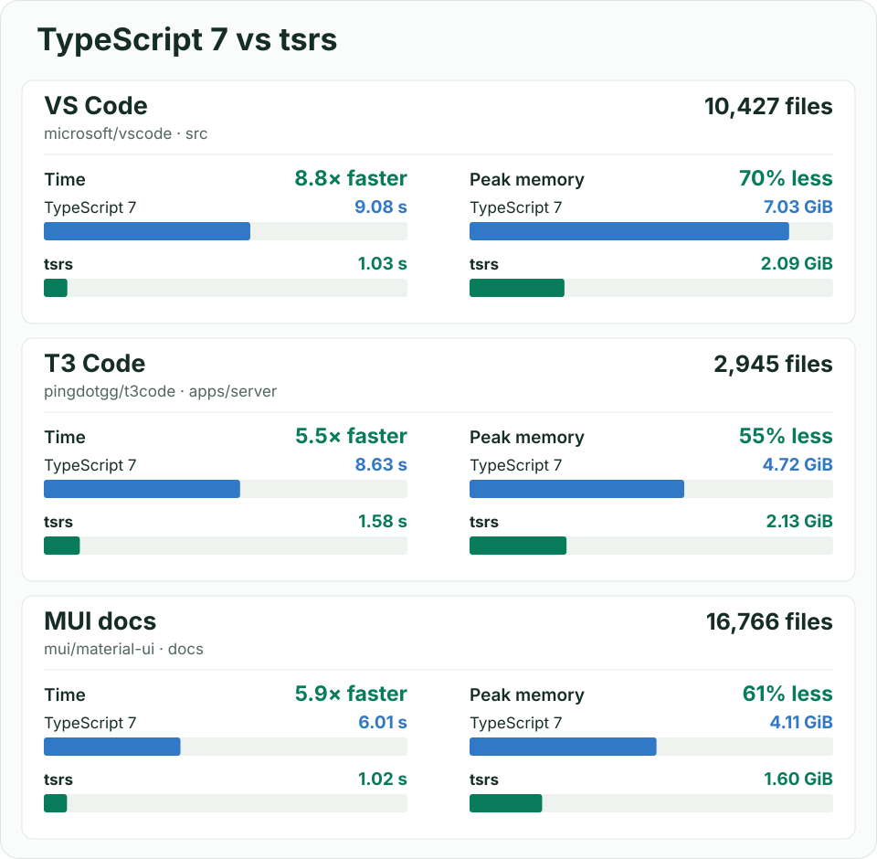

<!-- bench:start -->
<!-- Generated by bench/run.py from bench/results/; the bench workflow (.depot/workflows/bench.yml) rewrites this section. Edit the generator, not this text. -->
## Benchmark: tsrs vs tsgo 7.0.2 vs bun check

Time and peak memory to type-check each project (`-p <project> --noEmit`) on Depot CI `depot-ubuntu-24.04-16` (16 vCPU, 63 GB RAM, Linux x86_64, AMD EPYC 9R45 96-Core Processor). Median of 10 interleaved runs (3 for tsgo).

- **tsrs**: commit `3f1c229de87b`, PGO-optimized `dist` build, built like the npm release binaries.
- **tsgo**: npm `typescript@7.0.2`, the official Go compiler. tsrs ports a later 7.1-dev commit (`b85298b6`).
- **bun check**: Bun 1.4.4-canary.1+6c1eb067e.

Projects: vscode, xstate-main, webpack, mui-docs, Compiler, Compiler-Unions are from [microsoft/typescript-benchmarking](https://github.com/microsoft/typescript-benchmarking), the suite the TypeScript team benchmarks tsgo on; the other 11 are large open-source applications.

### Default settings on 16 vCPUs

No thread flags: tsgo runs 4 checker threads; tsrs runs 16 (its default: all cores up to 16, then half the cores, at most 32; fewer on small projects); bun check runs one thread per core.

**Wall time**

| project | tsgo | tsrs | bun check | tsrs vs tsgo | tsrs vs bun |
| --- | ---: | ---: | ---: | ---: | ---: |
| mui-docs | 11.86 s | 0.74 s | 7.34 s | **16.11x faster** | 9.97x faster |
| next-packages-next | 3.00 s | 0.21 s | 0.39 s | **14.40x faster** | 1.89x faster |
| vscode | 11.04 s | 0.82 s | 1.58 s | **13.49x faster** | 1.93x faster |
| mikro-orm | 10.46 s | 0.78 s | 1.97 s | **13.42x faster** | 2.53x faster |
| storybook | 1.60 s | 0.14 s | 0.28 s | **11.49x faster** | 2.01x faster |
| formbricks-web | 6.76 s | 0.61 s | 1.00 s | **11.02x faster** | 1.64x faster |
| supabase-studio | 6.53 s | 0.60 s | 1.58 s | **10.92x faster** | 2.64x faster |
| webpack | 1.29 s | 0.13 s | 0.30 s | **9.83x faster** | 2.25x faster |
| drizzle-orm | 1.81 s | 0.18 s | 0.42 s | **9.79x faster** | 2.27x faster |
| t3code-server | 13.27 s | 1.37 s | 2.71 s | **9.71x faster** | 1.98x faster |
| cal-diy | 5.44 s | 0.58 s | 1.47 s | **9.36x faster** | 2.53x faster |
| playwright | 1.13 s | 0.12 s | 0.23 s | **9.06x faster** | 1.82x faster |
| next-root | 1.56 s | 0.17 s | 0.30 s | **9.03x faster** | 1.74x faster |
| nuxt | 1.27 s | 0.17 s | 0.44 s | **7.64x faster** | 2.65x faster |
| xstate-main | 0.80 s | 0.11 s | 0.16 s | **7.04x faster** | 1.38x faster |
| Compiler-Unions | 0.52 s | 0.09 s | 0.20 s | **5.66x faster** | 2.21x faster |
| Compiler | 0.27 s | 0.06 s | 0.11 s | 4.22x faster | 1.73x faster |

**Peak memory**

| project | tsgo | tsrs | bun check | tsrs vs tsgo | tsrs vs bun |
| --- | ---: | ---: | ---: | ---: | ---: |
| mui-docs | 7.68 GiB | 1.60 GiB | 11.71 GiB | **4.81x less** | 7.33x less |
| next-packages-next | 1.76 GiB | 692 MiB | 741 MiB | 2.60x less | 1.07x less |
| vscode | 7.58 GiB | 2.09 GiB | 1.86 GiB | 3.63x less | 1.12x more |
| mikro-orm | 6.62 GiB | 1.98 GiB | 1.40 GiB | 3.35x less | 1.41x more |
| storybook | 1.37 GiB | 519 MiB | 608 MiB | 2.71x less | 1.17x less |
| formbricks-web | 5.75 GiB | 1.98 GiB | 1.62 GiB | 2.90x less | 1.22x more |
| supabase-studio | 4.42 GiB | 1.69 GiB | 1.22 GiB | 2.62x less | 1.38x more |
| webpack | 1.17 GiB | 536 MiB | 495 MiB | 2.24x less | 1.08x more |
| drizzle-orm | 1.74 GiB | 821 MiB | 728 MiB | 2.17x less | 1.13x more |
| t3code-server | 6.38 GiB | 2.10 GiB | 1.11 GiB | 3.04x less | 1.89x more |
| cal-diy | 4.31 GiB | 1.88 GiB | 1.30 GiB | 2.30x less | 1.44x more |
| playwright | 1.05 GiB | 495 MiB | 474 MiB | 2.17x less | 1.04x more |
| next-root | 1.29 GiB | 483 MiB | 565 MiB | 2.73x less | 1.17x less |
| nuxt | 1.16 GiB | 521 MiB | 540 MiB | 2.28x less | 1.04x less |
| xstate-main | 740 MiB | 279 MiB | 394 MiB | 2.65x less | 1.41x less |
| Compiler-Unions | 240 MiB | 99 MiB | 228 MiB | 2.41x less | 2.30x less |
| Compiler | 217 MiB | 97 MiB | 218 MiB | 2.23x less | 2.25x less |

**Errors.** tsgo and tsrs report the same errors on 9 of 17 projects. The other 8 differ only because TypeScript changed between 7.0.2 and the 7.1-dev commit tsrs ports: `typescript@7.1.0-dev.20260930.4`, built from that commit, reports exactly tsrs's errors (tsgo / tsrs): vscode 359 / 371, webpack 848 / 840, supabase-studio 0 / 9, t3code-server 5 / 6, next-packages-next 6 / 5, next-root 441 / 438, nuxt 3 / 4, drizzle-orm 10845 / 10846. bun check, which follows TypeScript 7.0 like tsgo, differs from tsgo on webpack (837 errors, tsgo 848).

Rows are sorted by speedup over tsgo. Wall time is the process's wall clock; peak memory is its maximum resident set size. Bold marks a win over tsgo of at least 5x in time or 4x in memory.

Shared CI machines vary by a few percent between runs of the same code; the single-threaded instruction counts in `bench/results/` are the exact measure. Date: 2026-10-11 15:32 UTC. tsrs commit: `3f1c229de87b`. Method: [`bench/README.md`](bench/README.md).
<!-- bench:end -->

# `tsrs`

[](https://www.npmjs.com/package/tsrs)
[](LICENSE)

`tsrs` is a **drop-in replacement for the TypeScript 7 compiler and language server**, written in Rust.
Our goal is **100% conformance**, with much lower memory use and faster type checking.

## Get started

```sh
pnpm add -D tsrs
pnpm exec tsrs --noEmit
```

[](bench/RESULTS.md#large-project-chart-snapshot)

## Compatibility

`tsrs` follows TypeScript 7.1-dev. It matches **13,458 of 13,462 error baselines** and all **12,779 type and symbol
baselines**; the four remaining error-baseline differences are test-harness artifacts.

`--watch`, `--init` and `--showConfig` are not supported. See [compatibility and evidence](docs/COMPATIBILITY.md)
for supported features and known gaps.

## Learn more

- [CLI usage and memory tuning](docs/USAGE.md)
- [Editor setup](docs/LSP.md#editor-setup)
- [Node API (unstable)](docs/NODE_API.md)
- [WebAssembly for Node and browsers](npm/tsrs-wasm/README.md)
- [Benchmarks and methodology](bench/README.md)
- [Release notes](docs/STATUS.md)

## Contributing

Issues and pull requests are currently disabled until we have the bandwidth to triage them.

See the [contributing guide](CONTRIBUTING.md)
for building from source and running the suites, the [Code of Conduct](CODE_OF_CONDUCT.md), and
[security policy](SECURITY.md) for reporting vulnerabilities.

## Acknowledgments

Thanks to [@JiangWeixian](https://github.com/JiangWeixian) for transferring the `tsrs` npm package name.

## License

`tsrs` is a derivative of TypeScript (Copyright Microsoft Corporation), licensed under [Apache-2.0](LICENSE).
The bundled `lib.*.d.ts` files are TypeScript's. See [NOTICE](NOTICE) for attribution.
Not affiliated with or endorsed by Microsoft.
